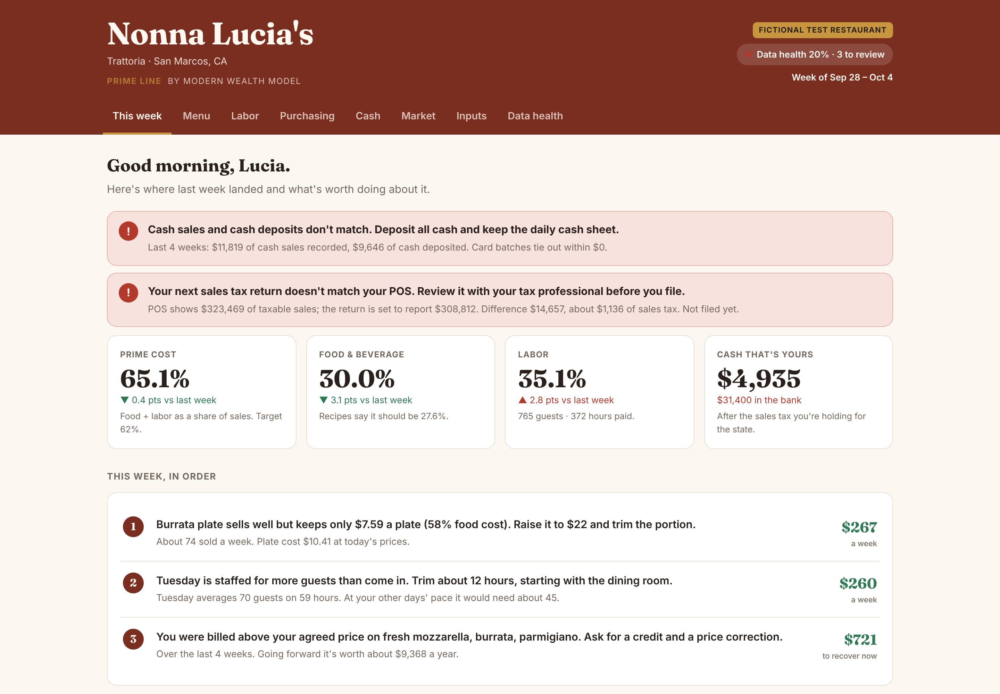
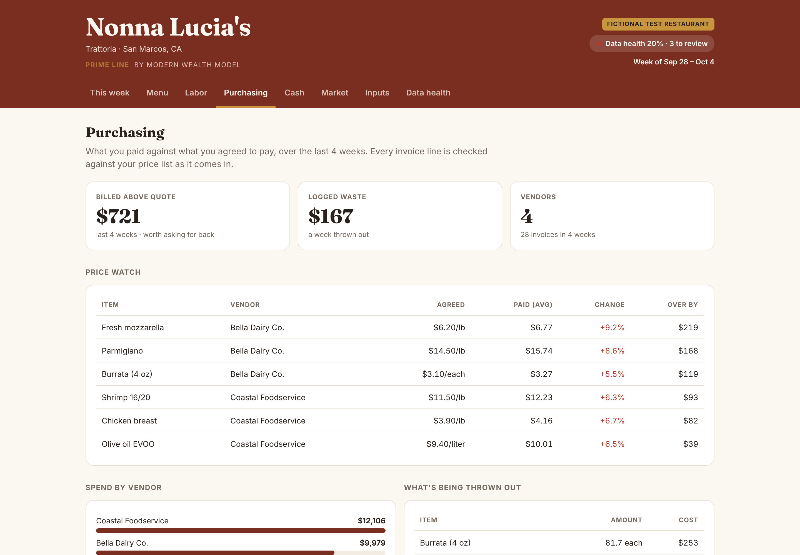
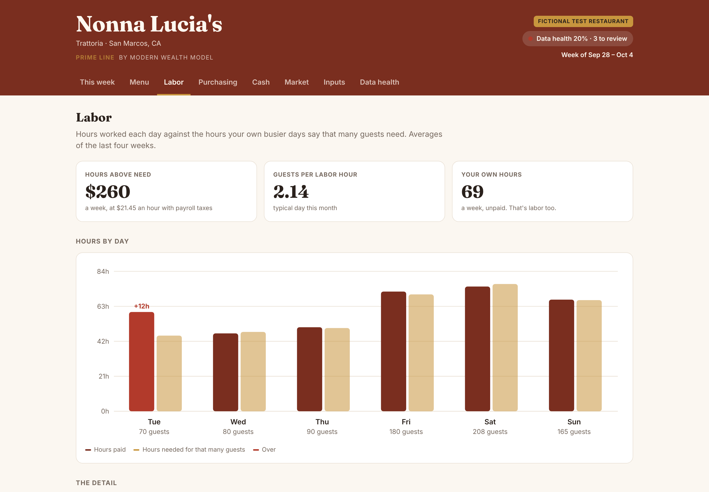
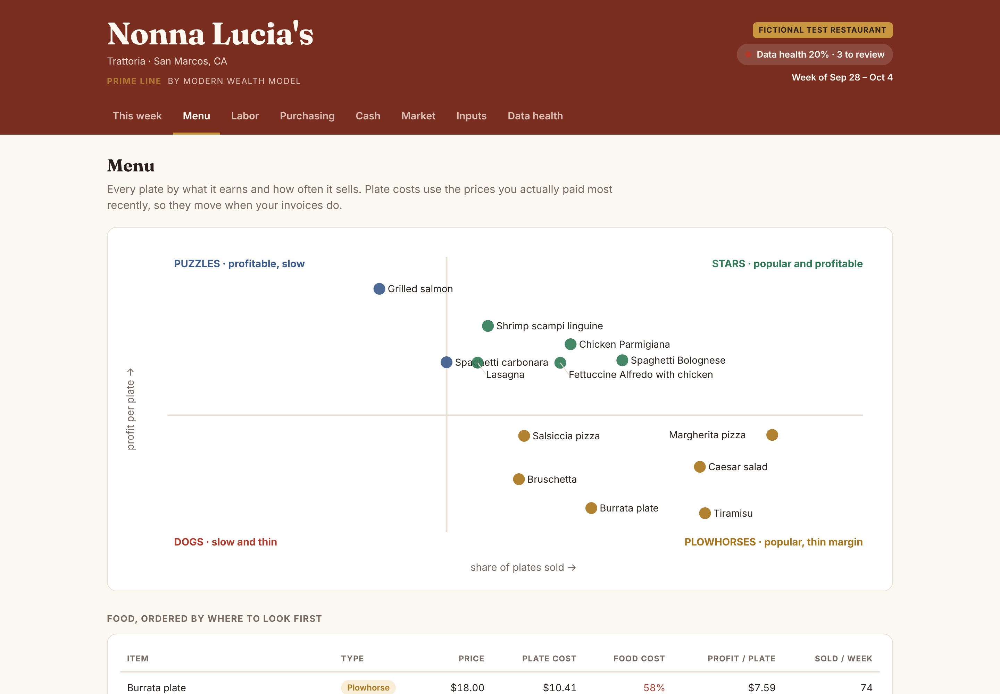

# Colin Reed

Operator turned builder. 18 years running foodservice distribution and airline catering operations. Now I run a portfolio of small businesses on AI agent systems I designed.

## What I build

- **Command Center** — one operating dashboard for a one-person business: pipeline, income, property and scheduling, with its own data-integrity checks.
- **Prime Line** — a locally run margin tool that finds food cost, labor and pricing leaks for independent restaurants. *(in development)*
- **DemandReady** — a live web app that drafts demand letters with state statute checks. [demandready.io](https://demandready.io)
- **SoCal Pitch** — a regional youth soccer directory and rankings engine. [socalpitch.com](https://socalpitch.com)
- **The Real Yield** — a food and agriculture publication with its own publishing tools. [therealyield.org](https://therealyield.org)
- **Agent operations** — scheduled agents that handle publishing, quality checks, backups and reporting across all of the above.

## How I work

Two AI agents, Sterling (operations) and Copper (field work), run on systems I design. I make the calls; they do the repetitive work, and every system checks its own output.

## Background

VP/GM-level operations in broadline foodservice, airline catering and last-mile delivery. MBA.

---

## Showcase

### Prime Line — restaurant margin tool *(in development)*

Independent restaurants lose margin in places nobody checks: vendor invoices that drift above the quoted price, Tuesday staffing that doesn't match Tuesday traffic, a best-selling plate that barely breaks even. Prime Line runs on the owner's own computer, reads the POS, time clock, payroll, bank and invoice files they already have, checks every number before it counts, and turns the week into three things worth doing, each with a dollar value. Shown on a fictional test restaurant.

More screens

---

Most of my code is private. More write-ups are coming to this page.

[modernwealthmodel.com](https://modernwealthmodel.com) · [LinkedIn](https://www.linkedin.com/in/creed52)
